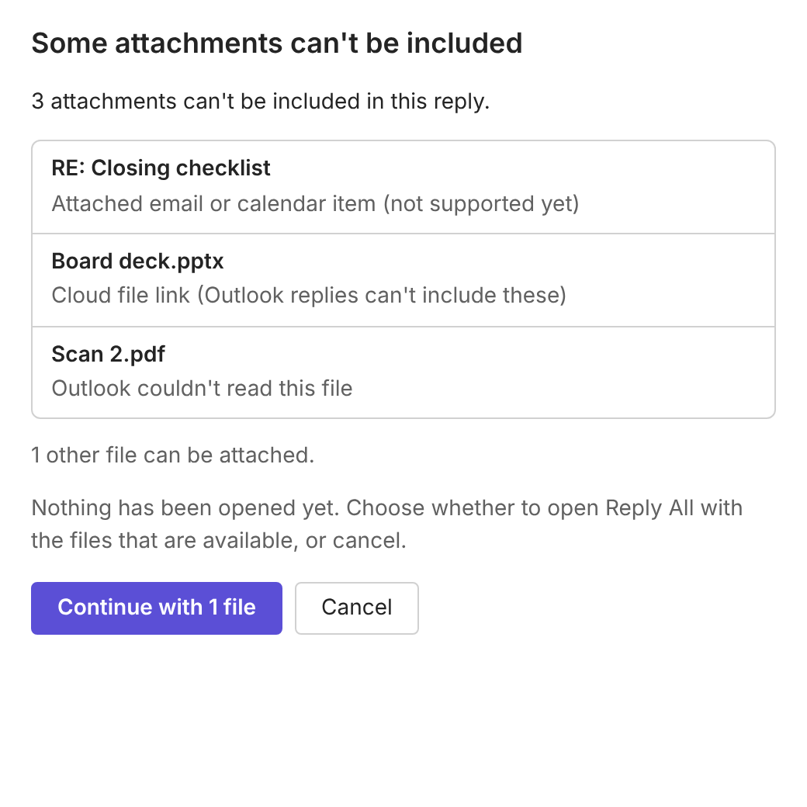

# Pilot notes: v1 behaviour and boundaries

## What the button does

1. Captures the message the button was clicked on (also in conversation view, the reading pane or a separate window) and its attachment list. Earlier messages in the conversation are never used.
2. Sorts the attachments:
   - **Ordinary files** (PDF, Word, Excel, attached images, etc.) are carried over.
   - **Inline images** (signature logos, pasted pictures) are left to Outlook's quoted body and are not added to the file list.
   - **Inline non-image files** (some mail apps, such as Apple Mail, mark PDFs inline) are treated as ordinary files so they are not silently dropped.
   - **Attached emails and calendar items**, **cloud links** (OneDrive/SharePoint "share link" attachments) and **protected wrappers** (`message.rpmsg`, `smime.p7m`) are not supported in v1.
3. Reads the files from Outlook, at most 3 at a time, keeping their original order, names and bytes. Two different files with the same name are both kept.
4. Opens exactly one native Reply All with `displayReplyAllFormAsync`, an empty body and the files attached as Base64 attachments. Outlook supplies the recipients, Reply-To handling, subject, quoted history and conversation threading. The add-in never builds recipients and never touches Bcc.

If there are no files to carry over, it opens an ordinary Reply All.

## The v1 boundary: nothing partial without asking

If any attachment can't be included (unsupported type, protected content, failed read, or a limit below), **no reply opens yet**. A dialog lists each affected file and why, then lets the sender:

- **Continue with N files**: opens Reply All with the files that could be read, or
- **Cancel**: opens nothing.

Closing the dialog counts as Cancel. If Outlook cannot show the dialog, nothing opens and an error appears on the message.

## Limits (provisional)

| Limit | Value | Source |
|---|---|---|
| Per file | 25 MB | Product cap, see below |
| Total per reply | 25 MB | Product cap, see below |
| Files per reply | 50 | Product cap |
| File name length | 255 characters | Documented `ReplyFormAttachment.name` limit |
| Single read timeout | 120 s | Treated as a failed read |

Exchange Online's default maximum send size is 35 MB, measured after Base64/MIME encoding adds about a third, so about 25 MB of raw files is the most a default mailbox can send in one message. Microsoft documents no size or count limit for Base64 reply attachments themselves.

**Not yet done:** benchmarking memory and behaviour near 25 MB in each live client. Holding 25 MB of files costs about 33 MB of Base64 text in the add-in, plus whatever copies Outlook makes when it receives them. Run the large-file fixtures in each client (see [test-plan.md](test-plan.md)) before treating these numbers as final. The caps are in `src/core/limits.ts`.

Sizes are checked twice: first using the sizes Outlook reports (so oversized files are never read into memory), then using the real decoded size after reading.

## What the add-in cannot observe

- After `displayReplyAllFormAsync` succeeds, Outlook downloads and attaches the files itself. Microsoft documents that if an attachment fails at that stage, Outlook shows an error **in the reply form**, and in some cases no error at all. The add-in is not told.
- The add-in cannot confirm that the sent message arrived with intact files. End-to-end delivery is verified only by the live test procedure (hash comparison on receipt).
- If Outlook reports an error opening the reply, the add-in shows the error code and **does not retry**, to avoid duplicate drafts. The message tells the sender to check for an open draft first.

## Repeat clicks and changed selection

- A second click while the first is still preparing is ignored. Each click opens at most one reply.
- If the selected message changes while files are being prepared, nothing opens and the sender is asked to try again.

## Privacy

- Message and file contents stay inside Outlook's add-in runtime. Nothing is uploaded anywhere.
- The web host (GitHub Pages) only serves static code and icons. File names shown in the dialog are passed in memory (`messageChild`), never in a URL.
- The add-in logs only event codes and counts (for example `opened {"files":2}`). It never logs file contents, file names, subjects, recipients, message bodies or item IDs. A unit test enforces that only `src/core/log.ts` writes to the console.

## Not in this build

- **Licensing, portal and billing.** The add-in has no sign-in or license check yet. The portal, seat assignment, magic-link sign-in, 24-hour offline grace and Stripe billing are a separate build. When the license check is added, the add-in will call that backend only for entitlement and will still never send mail content to it.
- Attached emails/calendar items and cloud attachments (v1 asks the sender instead).
